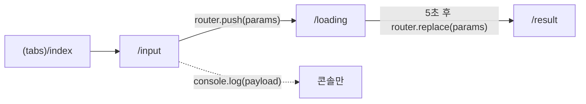
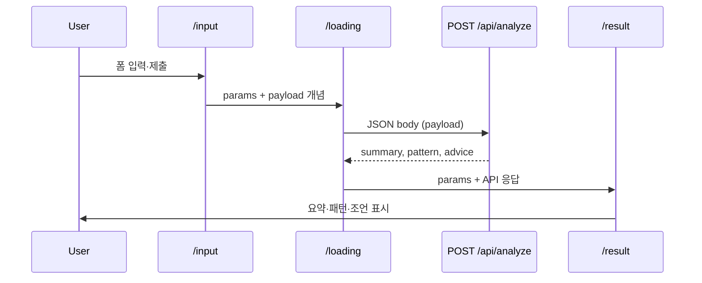

# 모바일 앱 프론트엔드 구조 분석

> 대상: `mobile-app/app` (Expo Router)  
> 웹 `frontend` 폴더는 제외  
> 분석 기준: 저장소 내 실제 코드 (`input.tsx`, `loading.tsx`, `result.tsx` 등)

---

## 목차

1. [앱 구조 개요](#1-앱-구조-개요)
2. [입력 화면 payload](#2-입력-화면-payload)
3. [서버 전송 형식](#3-서버-전송-형식)
4. [결과 화면에서 사용하는 데이터](#4-결과-화면에서-사용하는-데이터)
5. [전체 데이터 흐름](#5-전체-데이터-흐름)
6. [백엔드 연동 시 참고](#6-백엔드-연동-시-참고)

---

## 1. 앱 구조 개요

### 기술 스택

| 항목 | 내용 |
|------|------|
| 프레임워크 | React Native + **Expo Router** (파일 기반 라우팅) |
| 상태 저장 | 화면 간 **URL search params** (`router.push` / `useLocalSearchParams`) |
| HTTP API | **미구현** (`fetch` / `axios` 호출 없음) |

### `app/` 화면 구성

| 경로 | 파일 | 역할 |
|------|------|------|
| `/(tabs)/index` | `(tabs)/index.tsx` | 홈 → 「시작하기」로 `/input` 이동 |
| `/input` | `input.tsx` | 설문·메모·스크린샷 입력, payload 생성 |
| `/loading` | `loading.tsx` | 5초 로딩 UI 후 `/result`로 이동 |
| `/result` | `result.tsx` | 분석 결과 표시 (현재는 **클라이언트 목업**) |
| `/(tabs)/explore` | `(tabs)/explore.tsx` | 템플릿 탐색 화면 (분석 플로우와 무관) |
| `/modal` | `modal.tsx` | 모달 샘플 (분석 플로우와 무관) |

### 분석 플로우 라우팅

```
/(tabs)/index  →  /input  →  /loading  →  /result
                  (입력)     (대기)      (결과)
```

---

## 2. 입력 화면 payload

파일: `mobile-app/app/input.tsx`  
함수: `handleSubmit()`

### 2.1 코드에서 생성하는 객체

제출 시 아래 객체를 만들고 `console.log`만 합니다. **API로 전송하지 않습니다.**

```typescript
const payload = {
  mood,
  activity,
  fatigue,
  focusLevel,
  sleepQuality,
  stressLevel,
  distraction,
  digitalFeeling,
  aiHint,
  memo,
  hasScreenshot: Boolean(image),
};
```

### 2.2 필드 정의

| 필드 | 타입 | 필수 (앱 검증) | 설명 |
|------|------|:------------:|------|
| `mood` | string | O | 오늘 기분 |
| `activity` | string | O | 가장 중심이 된 활동 |
| `fatigue` | string | O | 피로도 |
| `focusLevel` | string | O | 집중도 |
| `sleepQuality` | string | X | 수면 상태 |
| `stressLevel` | string | X | 스트레스 정도 |
| `distraction` | string | X | 집중 방해 요소 |
| `digitalFeeling` | string | X | 디지털 사용 느낌 |
| `aiHint` | string | X | AI 분석 초점 |
| `memo` | string | O | 오늘 하루 메모 (공백만이면 불가) |
| `hasScreenshot` | boolean | — | 스크린샷 선택 여부 (`image` state 기준) |

### 2.3 선택지 (UI `ChoiceGroup` 옵션)

**mood**  
`좋음` · `보통` · `피곤함` · `불안함` · `무기력함`

**activity**  
`공부` · `과제` · `게임` · `영상 시청` · `SNS/채팅` · `휴식`

**fatigue**  
`낮음` · `보통` · `높음` · `매우 높음`

**focusLevel**  
`높음` · `보통` · `낮음` · `집중 어려움`

**sleepQuality**  
`충분함` · `보통` · `부족함` · `매우 부족함`

**stressLevel**  
`낮음` · `보통` · `높음` · `매우 높음`

**distraction**  
`알림` · `SNS` · `피로` · `주변 환경` · `없음`

**digitalFeeling**  
`적절했음` · `조금 많았음` · `많았음` · `조절이 어려웠음`

**aiHint**  
`집중 패턴` · `감정 변화` · `디지털 과사용` · `피로/회복` · `생활 균형`

### 2.4 클라이언트 검증 규칙

```text
필수: mood, activity, fatigue, focusLevel
필수: memo (trim 후 비어 있으면 alert)
스크린샷: 선택 (ImagePicker, 로컬 URI만 보관)
```

### 2.5 화면 이동 시 실제로 넘기는 데이터

`payload`와 별도로, `router.push` **params**에는 아래만 전달합니다.  
**`hasScreenshot`는 params에 없고**, 대신 `image`(로컬 파일 URI 문자열)가 있습니다.

```typescript
router.push({
  pathname: "/loading",
  params: {
    mood,
    activity,
    fatigue,
    focusLevel,
    sleepQuality,
    stressLevel,
    distraction,
    digitalFeeling,
    aiHint,
    memo,
    image: image ?? "",
  },
});
```

| 구분 | `payload` (console) | `router params` (loading/result) |
|------|---------------------|----------------------------------|
| `hasScreenshot` | 있음 (boolean) | **없음** |
| `image` | 없음 | 있음 (string, 없으면 `""`) |
| 그 외 입력 필드 | 동일 | 동일 (문자열) |

---

## 3. 서버 전송 형식

### 3.1 현재 앱 동작

- **서버 호출 없음.** `loading.tsx`는 5초 후 params를 그대로 `result`로 넘깁니다.
- 백엔드 `POST /api/analyze`는 앱과 **아직 연결되지 않은 상태**입니다.

### 3.2 백엔드가 기대하는 요청 (연동 시)

엔드포인트: `POST http://localhost:5000/api/analyze`  
헤더: `Content-Type: application/json`

```json
{
  "mood": "피곤함",
  "activity": "공부",
  "fatigue": "높음",
  "focusLevel": "높음",
  "sleepQuality": "부족함",
  "stressLevel": "보통",
  "distraction": "알림",
  "digitalFeeling": "조금 많았음",
  "aiHint": "집중 패턴",
  "memo": "오후에는 집중이 잘 됐어요",
  "hasScreenshot": true
}
```

**서버 필수 필드:** `mood`, `activity`, `fatigue`, `focusLevel`, `memo`  
**선택 필드:** `sleepQuality`, `stressLevel`, `distraction`, `digitalFeeling`, `aiHint`, `hasScreenshot`

> 연동 시 `loading.tsx`에서 `payload` 객체를 그대로 `fetch` body로내면 됩니다.  
> `hasScreenshot`는 `Boolean(image)` 또는 `image !== ""`로 맞추면 됩니다.  
> 스크린샷 **파일 바이너리**는 현재 API에서 받지 않습니다 (`image` URI는 앱 내부용).

### 3.3 백엔드 응답 형식

```json
{
  "summary": "하루 전체 요약 1문장",
  "pattern": "활동·패턴 분석 1문장",
  "advice": "개선·추천 1문장"
}
```

---

## 4. 결과 화면에서 사용하는 데이터

파일: `mobile-app/app/result.tsx`  
데이터 소스: `useLocalSearchParams()` (loading에서 전달된 **문자열 params**)

### 4.1 URL params로 읽는 필드

| param | 용도 |
|-------|------|
| `mood` | 요약 문장, 입력 정보 카드 |
| `activity` | 요약 문장, 입력 정보 카드 |
| `fatigue` | 피로 점수 계산, 입력 정보 카드 |
| `focusLevel` | 집중 점수 계산, 입력 정보 카드 |
| `sleepQuality` | 입력 정보 카드 |
| `stressLevel` | 스트레스 점수 계산, 입력 정보 카드 |
| `distraction` | 입력 정보 카드 |
| `digitalFeeling` | 입력 정보 카드 |
| `aiHint` | 입력 정보 카드 |
| `memo` | 입력 정보 카드 본문 |
| `image` | 스크린샷 `<Image source={{ uri: image }} />` (없으면 안내 문구) |

**사용하지 않는 param:** `hasScreenshot` (result에 전달되지 않음)

### 4.2 화면 내부에서 계산하는 값 (서버 응답 아님)

| 변수 | 입력 | 로직 요약 |
|------|------|-----------|
| `stressScore` | `stressLevel` | 매우 높음 88 / 높음 72 / 보통 48 / 그 외 25 |
| `focusScore` | `focusLevel` | 높음 85 / 보통 62 / 낮음 40 / 그 외 22 |
| `fatigueScore` | `fatigue` | 매우 높음 90 / 높음 70 / 보통 45 / 그 외 20 |
| `emotionSummary` | `mood` | 불안·무기력·피곤·좋음 등에 따른 고정 문장 |

### 4.3 UI 섹션별 데이터 출처

| UI 섹션 | 데이터 출처 |
|---------|-------------|
| AI 종합 분석 (요약 문단) | `activity`, `mood`, `emotionSummary` + **하드코딩** 문장 |
| AI 패턴 점수 (막대 그래프) | `stressScore`, `focusScore`, `fatigueScore` (클라이언트 계산) |
| 입력 정보 요약 | params 전 필드 |
| AI 추천 | **전부 하드코딩** (서버 `advice` 미사용) |
| 스크린샷 참고 자료 | `image` URI |

### 4.4 서버 응답과의 갭

| 백엔드 필드 | result 화면 사용 여부 |
|-------------|----------------------|
| `summary` | **미사용** |
| `pattern` | **미사용** |
| `advice` | **미사용** |

연동 후에는 `loading`에서 API 응답을 params 또는 context로 `result`에 넘기도록 **앱 코드 수정이 필요**합니다 (본 문서 범위 외).

---

## 5. 전체 데이터 흐름

### 5.1 현재 구현 (프로토타입)



```text
1. 사용자가 /input 에서 선택·메모·스크린샷 입력
2. handleSubmit:
   - payload 객체 생성 (hasScreenshot 포함)
   - params 객체로 /loading 이동 (image URI 포함, hasScreenshot 없음)
3. /loading:
   - API 호출 없음
   - 5초 대기 + 로딩 문구 순환
   - 동일 params를 /result 로 replace
4. /result:
   - params로 UI 렌더
   - 점수·요약·추천은 화면 내 규칙/고정 문장
   - 백엔드 summary/pattern/advice 미반영
```

### 5.2 연동 후 권장 흐름



```text
권장 연동 위치: loading.tsx 의 useEffect
  - POST http://localhost:5000/api/analyze
  - body: input 과 동일한 payload 구조
  - 성공 시 result 로 summary, pattern, advice 전달
```

---

## 6. 백엔드 연동 시 참고

### 6.1 요청 body 매핑

| 앱 `payload` 필드 | 백엔드 `req.body` | 비고 |
|-------------------|-------------------|------|
| `mood` | `mood` | 동일 |
| `activity` | `activity` | 동일 |
| `fatigue` | `fatigue` | 동일 |
| `focusLevel` | `focusLevel` | 동일 |
| `sleepQuality` | `sleepQuality` | 미선택 시 `""` 가능 |
| `stressLevel` | `stressLevel` | 미선택 시 `""` 가능 |
| `distraction` | `distraction` | 미선택 시 `""` 가능 |
| `digitalFeeling` | `digitalFeeling` | 미선택 시 `""` 가능 |
| `aiHint` | `aiHint` | 미선택 시 `""` 가능 |
| `memo` | `memo` | 필수 |
| `hasScreenshot` | `hasScreenshot` | params에는 없음 → API 호출 시 payload 기준 사용 |

### 6.2 실기기·에뮬레이터 API URL

| 환경 | Base URL 예시 |
|------|----------------|
| Android 에뮬레이터 | `http://10.0.2.2:5000` |
| iOS 시뮬레이터 | `http://localhost:5000` |
| 실제 기기 (LAN) | `http://<PC_IP>:5000` |

### 6.3 관련 백엔드 문서

- API 상세·규칙 기반 분석: 동일 폴더 `FRONTEND_API_SPEC.md` (웹 기준 일부는 구버전, 모바일 API는 `index.js` + `analyzeService.js` 기준)
- 모바일 요청/응답 최신 스펙: `backend/index.js`, `backend/analyzeService.js`

---

## 부록: 파일별 핵심 코드 위치

| 파일 | 참고 함수/훅 |
|------|----------------|
| `input.tsx` | `handleSubmit`, `payload`, `router.push` |
| `loading.tsx` | `useLocalSearchParams`, `setTimeout` → `router.replace` |
| `result.tsx` | `useLocalSearchParams`, 점수 계산, UI 섹션 |

---

*이 문서는 mobile-app 코드 정적 분석 결과입니다. API 연동은 mobile-app 수정이 필요하며, 본 저장소 시점에서는 loading 단계에서 서버를 호출하지 않습니다.*
