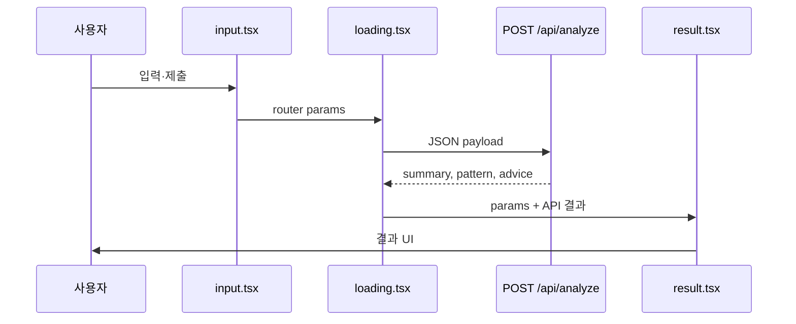

# 모바일 앱 API 연동 스펙 (분석 정리)

> 대상: `mobile-app/app` (Expo Router)  
> 분석 기준: 실제 코드 정적 분석 (`input.tsx`, `loading.tsx`, `result.tsx`)  
> 웹 `frontend` 폴더는 제외  
> 목적: 백엔드 API 설계·연동 시 참고

---

## 목차

1. [사용하는 입력 데이터](#1-사용하는-입력-데이터)
2. [API 연결이 필요한 부분](#2-api-연결이-필요한-부분)
3. [백엔드 응답 JSON 형식](#3-백엔드-응답-json-형식)
4. [전체 데이터 흐름](#4-전체-데이터-흐름)

---

## 1. 사용하는 입력 데이터

### 1.1 화면·파일 구조

| 경로 | 파일 | 역할 |
|------|------|------|
| `/(tabs)/index` | `(tabs)/index.tsx` | 홈 → `/input` 이동 |
| `/input` | `input.tsx` | **입력·payload 생성** |
| `/loading` | `loading.tsx` | 로딩 UI (현재 API 없음) |
| `/result` | `result.tsx` | 결과 표시 |

### 1.2 제출 시 생성하는 payload

`input.tsx` → `handleSubmit()` 에서 정의:

```json
{
  "mood": "...",
  "activity": "...",
  "fatigue": "...",
  "focusLevel": "...",
  "sleepQuality": "...",
  "stressLevel": "...",
  "distraction": "...",
  "digitalFeeling": "...",
  "aiHint": "...",
  "memo": "...",
  "hasScreenshot": true
}
```

| 필드 | 타입 | 앱 필수 | 설명 |
|------|------|:-------:|------|
| `mood` | string | O | 오늘 기분 |
| `activity` | string | O | 오늘 가장 중심이 된 활동 |
| `fatigue` | string | O | 오늘 피로도 |
| `focusLevel` | string | O | 오늘 집중도 |
| `sleepQuality` | string | X | 수면 상태 |
| `stressLevel` | string | X | 스트레스 정도 |
| `distraction` | string | X | 집중을 방해한 요소 |
| `digitalFeeling` | string | X | 오늘 디지털 사용 느낌 |
| `aiHint` | string | X | AI가 중점적으로 볼 부분 |
| `memo` | string | O | 오늘 하루 메모 (공백 불가) |
| `hasScreenshot` | boolean | — | 스크린샷 선택 여부 |

### 1.3 UI 선택지 (허용 값)

**mood**  
`좋음` · `보통` · `피곤함` · `불안함` · `무기력함`

**activity**  
`공부` · `과제` · `게임` · `영상 시청` · `SNS/채팅` · `휴식`

**fatigue**  
`낮음` · `보통` · `높음` · `매우 높음`

**focusLevel**  
`높음` · `보통` · `낮음` · `집중 어려움`

**sleepQuality**  
`충분함` · `보통` · `부족함` · `매우 부족함`

**stressLevel**  
`낮음` · `보통` · `높음` · `매우 높음`

**distraction**  
`알림` · `SNS` · `피로` · `주변 환경` · `없음`

**digitalFeeling**  
`적절했음` · `조금 많았음` · `많았음` · `조절이 어려웠음`

**aiHint**  
`집중 패턴` · `감정 변화` · `디지털 과사용` · `피로/회복` · `생활 균형`

### 1.4 스크린샷

- `expo-image-picker`로 갤러리에서 이미지 선택
- 로컬 URI만 state에 보관 (`image`)
- `hasScreenshot: Boolean(image)` — API용 플래그
- **이미지 파일 자체는 서버로 전송하지 않음** (현재 구조)

### 1.5 payload vs 화면 간 전달(params)

앱은 **두 가지 경로**로 데이터를 다룹니다.

| 항목 | `payload` (console.log) | `router` params (`/loading` → `/result`) |
|------|-------------------------|------------------------------------------|
| 입력 10필드 | O | O (문자열) |
| `hasScreenshot` | O (boolean) | **없음** |
| `image` | 없음 | O (로컬 URI, 없으면 `""`) |

→ **서버 API 호출 시에는 `payload` 구조를 그대로 사용**하는 것이 맞습니다.

### 1.6 클라이언트 검증 (`input.tsx`)

```text
필수: mood, activity, fatigue, focusLevel
필수: memo (trim 후 비어 있으면 alert)
```

---

## 2. API 연결이 필요한 부분

### 2.1 현재 상태

| 항목 | 내용 |
|------|------|
| HTTP 클라이언트 | **없음** (`fetch`, `axios` 미사용) |
| 분석 처리 | `loading.tsx`에서 **5초 대기** 후 params만 `result`로 전달 |
| AI 문장 | `result.tsx`에서 **하드코딩·로컬 점수 계산** |

### 2.2 연동이 필요한 위치

#### (1) `/loading` — **핵심 연동 지점 (권장)**

| 항목 | 내용 |
|------|------|
| 파일 | `mobile-app/app/loading.tsx` |
| 현재 | `setTimeout` 5초 → `router.replace({ pathname: "/result", params })` |
| 필요 작업 | `POST /api/analyze` 호출 후 응답을 `result`에 전달 |

```text
입력 params 수신 → API 요청(body = payload 형식) → summary/pattern/advice 수신 → result로 이동
```

#### (2) `/input` — 선택적 (대안)

| 항목 | 내용 |
|------|------|
| 파일 | `mobile-app/app/input.tsx` |
| 현재 | `payload` 생성 후 `console.log`만 수행 |
| 대안 | 제출 직후 API 호출 → loading은 순수 로딩 UI만 담당 |

#### (3) `/result` — API 연동 후 **표시 수정 필요**

| 항목 | 내용 |
|------|------|
| 파일 | `mobile-app/app/result.tsx` |
| 현재 | `summary` / `pattern` / `advice` **미사용** |
| 필요 작업 | API 응답 필드를 「AI 종합 분석」「AI 추천」 등에 바인딩 |

> 백엔드만 구현해도 화면에는 반영되지 않습니다. **loading + result 수정**이 함께 필요합니다.

### 2.3 API 엔드포인트 (백엔드 구현됨)

| 메서드 | URL | 설명 |
|--------|-----|------|
| `GET` | `/health` | 서버 상태 확인 |
| `POST` | `/api/analyze` | 하루 분석 (모바일 payload) |

기본 URL: `http://localhost:5000` (실기기·에뮬레이터는 호스트 IP 조정 필요)

### 2.4 연동 시 요청 형식

```http
POST /api/analyze HTTP/1.1
Host: localhost:5000
Content-Type: application/json
```

요청 body 예시:

```json
{
  "mood": "피곤함",
  "activity": "공부",
  "fatigue": "높음",
  "focusLevel": "높음",
  "sleepQuality": "부족함",
  "stressLevel": "보통",
  "distraction": "알림",
  "digitalFeeling": "조금 많았음",
  "aiHint": "집중 패턴",
  "memo": "오후에는 집중이 잘 됐어요",
  "hasScreenshot": false
}
```

**백엔드 필수:** `mood`, `activity`, `fatigue`, `focusLevel`, `memo`  
**선택:** 나머지 문자열 필드, `hasScreenshot`

---

## 3. 백엔드 응답 JSON 형식

### 3.1 성공 응답 (200)

모바일 연동·현재 백엔드(`analyzeService.js`) 기준:

```json
{
  "summary": "오늘은 공부 중심의 활동이 이루어진 것으로 보입니다, 피로도가 다소 높은 상태로 보입니다, ...",
  "pattern": "집중 흐름이 비교적 잘 유지된 패턴으로 보입니다, ...",
  "advice": "가능하다면 휴식 시간을 늘리고 수면 리듬을 안정화하는 것이 도움이 될 수 있습니다."
}
```

| 필드 | 타입 | 설명 | 모바일 UI 매핑 (연동 후) |
|------|------|------|--------------------------|
| `summary` | string | 하루 전체 요약 (1문장 권장) | 「AI 종합 분석」상단 요약 |
| `pattern` | string | 활동·패턴 분석 (1문장 권장) | 「AI 종합 분석」보조 문단 또는 별도 섹션 |
| `advice` | string | 개선·추천 (1문장 권장) | 「AI 추천」섹션 |

### 3.2 응답 예시 (공부 + 피로 높음)

**요청**

```json
{
  "mood": "피곤함",
  "activity": "공부",
  "fatigue": "높음",
  "focusLevel": "높음",
  "sleepQuality": "부족함",
  "stressLevel": "보통",
  "distraction": "알림",
  "digitalFeeling": "적절했음",
  "aiHint": "집중 패턴",
  "memo": "오후에 과제를 마쳤다",
  "hasScreenshot": false
}
```

**응답**

```json
{
  "summary": "오늘은 공부 중심의 활동이 이루어진 것으로 보입니다, 피로도가 다소 높은 상태로 보입니다, 전반적인 기분은 '피곤함'(으)로 기록되었습니다, 메모에는 \"오후에 과제를 마쳤다\"라고 남기셨습니다.",
  "pattern": "집중 흐름이 비교적 잘 유지된 패턴으로 보입니다, 학습·과제 중심의 목표 지향적 활동 비중이 높았을 수 있습니다, 피로 누적으로 인지 자원이 소모된 흐름이 반영되었을 수 있습니다, 수면 부족이 하루 컨디션과 집중에 영향을 주었을 수 있습니다, '알림'(이)가 집중을 방해한 요소로 작용했을 가능성이 있습니다, 집중 리듬의 변화에 특히 주목할 필요가 있습니다.",
  "advice": "가능하다면 휴식 시간을 늘리고 수면 리듬을 안정화하는 것이 도움이 될 수 있습니다."
}
```

### 3.3 오류 응답

**400 — body 형식 오류**

```json
{
  "error": "Invalid request body",
  "message": "JSON 객체 형식의 body가 필요합니다."
}
```

**400 — 필수 필드 누락**

```json
{
  "error": "Missing required fields",
  "message": "mood, activity, fatigue, focusLevel은 필수입니다."
}
```

```json
{
  "error": "Missing required fields",
  "message": "memo는 필수입니다."
}
```

**400 — JSON 파싱 실패**

```json
{
  "error": "Invalid JSON",
  "message": "요청 body가 올바른 JSON 형식이 아닙니다."
}
```

**500**

```json
{
  "error": "Internal Server Error"
}
```

### 3.4 result 화면과의 관계 (현재)

`result.tsx`가 **직접 사용하는 것**은 URL params뿐이며, 아래는 **클라이언트에서만** 계산합니다.

| 데이터 | 출처 |
|--------|------|
| `stressScore`, `focusScore`, `fatigueScore` | params → 화면 내 if/else |
| `emotionSummary` | `mood` → 고정 문장 매핑 |
| AI 요약·추천 본문 | **하드코딩** |

| 백엔드 필드 | result 사용 (현재) |
|-------------|-------------------|
| `summary` | 미사용 |
| `pattern` | 미사용 |
| `advice` | 미사용 |

연동 시 `loading` → `result`로 `summary`, `pattern`, `advice`를 params 또는 전역 상태로 넘기도록 앱 수정이 필요합니다.

---

## 4. 전체 데이터 흐름

### 4.1 현재 (프로토타입)

```
[홈] → [input: 폼 입력]
         ├─ payload 생성 (hasScreenshot)
         └─ router.push → [loading: params + image URI]
                              └─ 5초 대기 (API 없음)
                                   └─ [result: params만 사용, 로컬 목업 분석]
```

### 4.2 연동 후 (목표)

```
[input] payload 생성
    ↓
[loading] POST /api/analyze  ←── JSON body (payload)
    ↓
[백엔드] { summary, pattern, advice }
    ↓
[result] params + API 응답 표시
```

### 4.3 시퀀스 (연동 후)



---

## 부록: 백엔드 분석 규칙 요약

`analyzeService.js` 규칙 기반 생성 (참고):

| 입력 조건 | 반영 내용 |
|-----------|-----------|
| `activity` = `공부` / `과제` | 학습·집중 중심 문장 |
| `activity` = `게임` / `영상 시청` | 디지털·자극 관련 문장 |
| `fatigue` = `높음` / `매우 높음` | 피로 관련 문장 |
| `focusLevel` = `높음` | 집중 긍정 |
| `focusLevel` = `낮음` / `집중 어려움` | 집중 저하 |
| `sleepQuality` = `부족함` / `매우 부족함` | 컨디션 저하 |
| `stressLevel` = `높음` / `매우 높음` | 스트레스 |
| `distraction` 존재 (`없음` 제외) | 방해 요소 |
| `digitalFeeling` = `많았음` / `조절이 어려웠음` | 디지털 과사용 |
| `aiHint` 있음 | 분석 방향 강조 |
| `memo` | 일부 인용 |

---

## 관련 문서

| 파일 | 설명 |
|------|------|
| `MOBILE_APP_ANALYSIS.md` | 화면 구조·필드·흐름 상세 |
| `backend/index.js` | API 라우트 구현 |
| `backend/analyzeService.js` | 응답 문장 생성 로직 |

---
